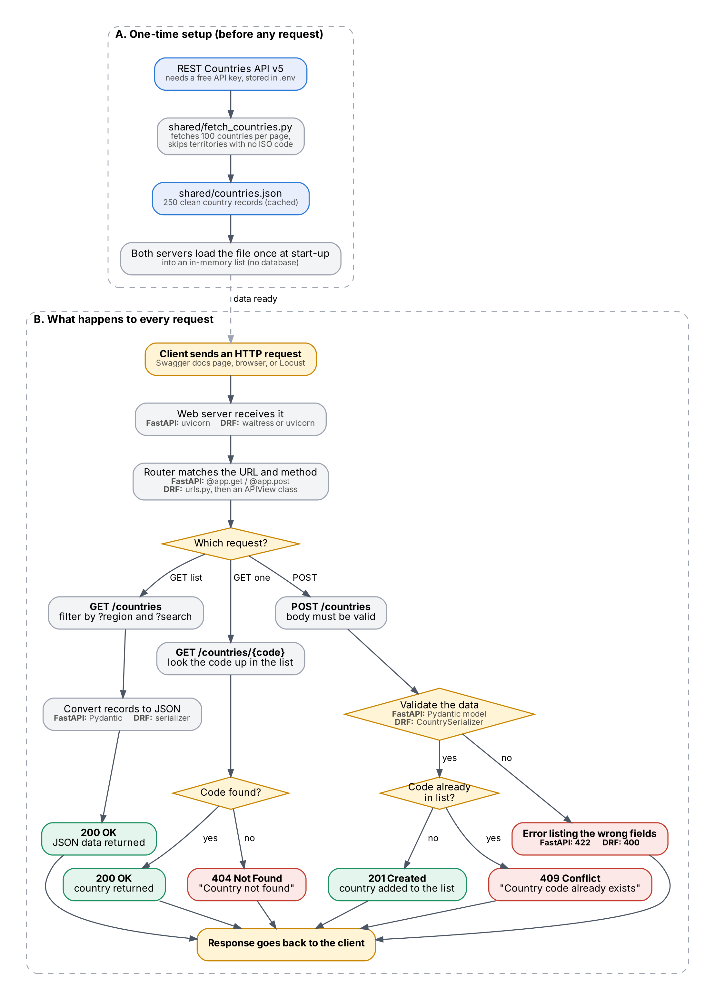
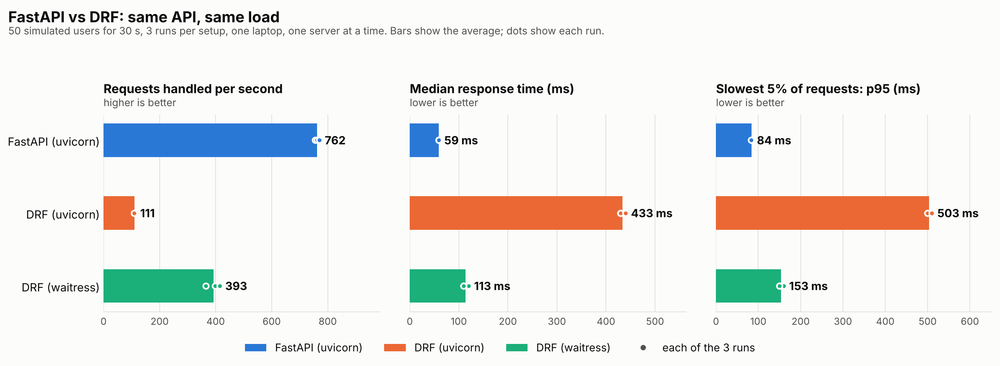
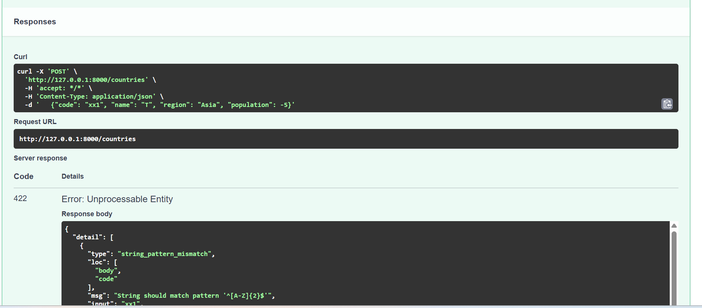
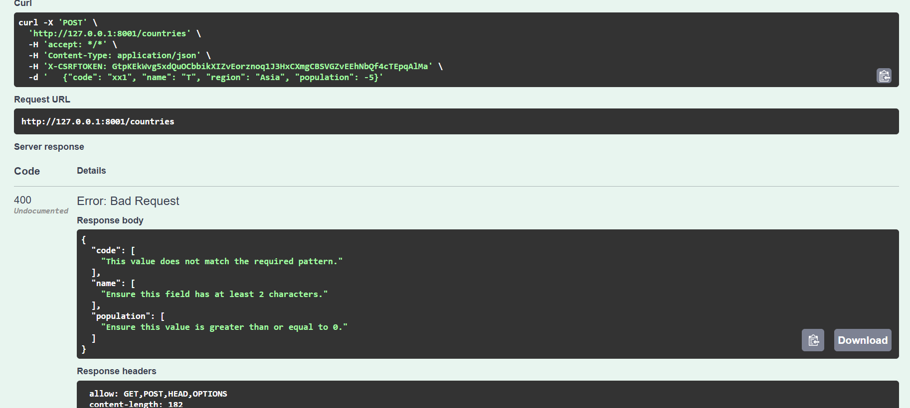
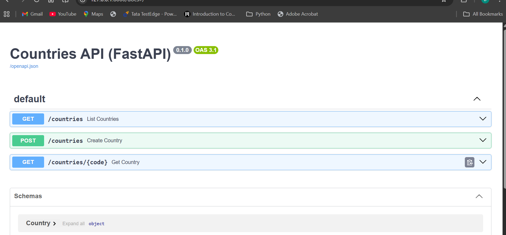
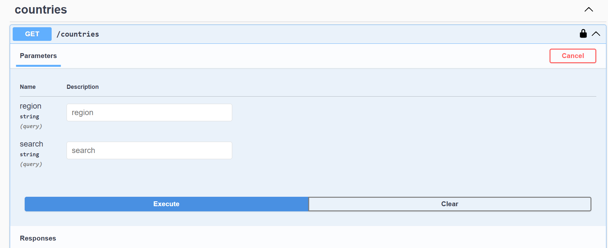

# Django REST Framework vs FastAPI

**IMAP group project, Topic 7.** We built the *same small countries API* twice, once with Django REST Framework (DRF) and once with FastAPI, and compared code size, speed, validation and auto-generated docs.

Data source: [REST Countries API](https://restcountries.com) (v5).

## Members and roles

| Member | Responsibility |
|---|---|
| Dhriti Vichhivora | Repository and data pipeline, FastAPI app, DRF app, benchmark and charts, flowchart, research question 1 |
| Tanvi Khanvilkar | Setup instructions (tested from a clean install), README review, research question 2 |
| Navya Shah | Validation and edge-case testing on both APIs, screenshots, research question 3 |
| Shreeya Gore | Demo script and question practice, report review, research answers review |

## What we built

Both apps expose the same three endpoints on the same data (250 countries):

| Endpoint | What it does |
|---|---|
| `GET /countries` | List countries. Optional filters: `?region=Asia`, `?search=ind` |
| `GET /countries/{code}` | One country by its 2-letter code, e.g. `IN`. Returns 404 if unknown |
| `POST /countries` | Add a country. The body is validated; invalid data is rejected |

Validation rules (identical in both apps): `code` = 2 capital letters, `name` = at least 2 characters, `region` = not empty, `population` = 0 or more.

## Architecture and flowchart



Step-by-step explanation of the flowchart: [docs/how_it_works.md](docs/how_it_works.md)

## Project structure

```
shared/        fetch_countries.py (downloads and cleans the data) + countries.json (cached copy)
fastapi_app/   the FastAPI version (main.py)
drf_app/       the DRF version (Django project + countries app)
benchmarks/    Locust load test, runner script, chart script, results.json
docs/          flowchart, screenshots, research answers, notes
```

## Setup (Windows)

1. Clone the repository and open a Command Prompt in its folder:
   ```
   git clone https://github.com/DhritiVichhivora/drf-vs-fastapi-comparison.git
   cd drf-vs-fastapi-comparison
   ```
2. Create and activate a virtual environment, then install everything:
   ```
   python -m venv .venv
   .venv\Scripts\activate
   pip install -r requirements.txt
   ```
3. **API key (only needed to re-download the data).** The cached file `shared/countries.json` is already in the repository, so the apps run without a key. To refresh the data, get a free key at https://restcountries.com/sign-up, copy `.env.example` to `.env`, and put your key in it:
   ```
   RESTCOUNTRIES_API_KEY=your_key_here
   ```
   Then run `python shared\fetch_countries.py`. The `.env` file is ignored by Git and must never be committed.

## Run the apps

**FastAPI** (port 8000):
```
cd fastapi_app
uvicorn main:app --reload
```
Open http://127.0.0.1:8000/docs

**DRF** (port 8001), in a second window:
```
cd drf_app
python manage.py runserver 8001
```
Open http://127.0.0.1:8001/docs/ (ignore the "unapplied migrations" warning, we use no database).

## Run the benchmark

Stop both servers first (the script starts its own), then from the project root:
```
python benchmarks\run_benchmark.py     # about 7 minutes; saves benchmarks/results.json
python benchmarks\make_charts.py       # draws docs/benchmark_charts.png
```
Use `--quick` with the first command for a short test run.

## Results

### 1. Code size

| | FastAPI | DRF |
|---|---|---|
| Files we wrote or edited | 1 | 5 |
| Total lines | 48 | about 93 |
| Lines of code (no blanks or comments) | 36 | about 76 |
| Python files in the project | 1 | 15 (most generated by Django) |

Part of DRF's extra lines is the code that makes its documentation page show our filters and responses. FastAPI gets that automatically from its type hints.

### 2. Speed

Load test with Locust: 50 simulated users for 30 seconds, 3 runs per setup, one server running at a time on one laptop. Every request was a GET on our own local server (never the public API). 0 failures in all runs.

| Setup | Requests per second (higher is better) | Median response (ms) | p95 response (ms) |
|---|---|---|---|
| **FastAPI (uvicorn)** | **762** | **59** | **84** |
| DRF (waitress) | 393 | 113 | 153 |
| DRF (uvicorn) | 111 | 433 | 503 |



Limits of this test: Locust and the server share one laptop, so the numbers compare the frameworks under identical conditions but do not predict production performance. We tested DRF on two servers because Waitress (built for synchronous code) is DRF's natural fit, while uvicorn (built for async code) shows the cost of mixing the two.

### 3. Validation

We sent the same invalid body to both apps: `{"code": "xx1", "name": "T", "region": "Asia", "population": -5}`

| | FastAPI | DRF |
|---|---|---|
| Status code | 422 Unprocessable Entity | 400 Bad Request |
| Error format | Detailed list: type, location, message, the input we sent | Simple list of messages per field |
| Errors found | `code`, `name`, `population` | `code`, `name`, `population` |

| FastAPI | DRF |
|---|---|
|  |  |

### 4. Auto-generated docs

| | FastAPI | DRF |
|---|---|---|
| Docs page | `/docs` (built in, nothing to set up) | `/docs/` (needed the extra package `drf-spectacular` and some decorators) |
| Error responses listed | 422 listed automatically | 400 and 404 show as "Undocumented" unless we declare them |

| FastAPI | DRF |
|---|---|
|  |  |

More screenshots (200, 404 and 400 responses for both apps) are in the [docs](docs/) folder.


## Challenges we faced

- **The REST Countries API changed.** The old v3.1 API (no key needed) was shut down and now returns a "deprecated" error. We migrated to v5, which needs a free API key, so we store the key in a `.env` file that Git ignores and provide `.env.example`.
- **The new API returns at most 100 countries per request**, so our fetch script pages through the results, and the new response is nested differently, so the script flattens it into six simple fields.
- **Validation caught bad data.** Four territories (Abkhazia, Northern Cyprus, Somaliland, South Ossetia) have no ISO country code. They broke the code rule and made the FastAPI list endpoint return a 500 error, so we filter them out when fetching.
- **Fair benchmarking.** Django's built-in `runserver` is a development server, so we benchmarked DRF on production-style servers instead (waitress and uvicorn).

## Research questions

### Question 1: What is the difference between synchronous and asynchronous programming?

Synchronous programming executes tasks one by one, waiting for each task to finish before moving to the next. Asynchronous programming allows the server to handle other requests while waiting for tasks like database queries or external API calls to complete.

In our project, we used normal `def` functions, so we did not implement asynchronous programming. Our data is already in memory, so there was nothing to wait for, which is why async would not have helped much here. FastAPI was most likely faster because it does less work per request, not because of async. We measured approximately 762 requests per second with FastAPI, compared to 393 with DRF on Waitress. DRF on uvicorn did even worse (about 111 requests per second), because DRF is synchronous code running on a server built for async code. Waitress is built for synchronous code, which is why DRF did better there.

### Question 2: How does each framework validate data?

FastAPI uses Pydantic models with Python type hints and rules such as `Field(ge=0)` to validate incoming data automatically. The same model also feeds the automatic `/docs` page. Django REST Framework (DRF) uses serializers with fields such as `IntegerField(min_value=0)`, and the view calls `is_valid()` to check the data.

In our project, both frameworks used the same validation rules: the country code must contain two capital letters, the name must have at least two characters, and the population must be zero or greater. FastAPI returned a 422 status code with a detailed list (type, location, message and the input we sent), while DRF returned a 400 status code with a simpler list of messages for each field.

Validation also caught a real problem in our data: our first FastAPI test returned a 500 error because four territories (Abkhazia, Northern Cyprus, Somaliland and South Ossetia) have no country code and broke the code rule. We removed them from the data.

### Question 3: When would you choose FastAPI or Django REST Framework?

I would choose FastAPI for lightweight, high-performance APIs and microservices where speed, simplicity, and automatic API documentation are important. In our project, FastAPI required only one file with 48 lines of code and achieved approximately 762 requests per second.

I would choose Django REST Framework (DRF) for larger applications that need Django's ORM, built-in admin panel, authentication, permissions, and extensive ecosystem. In our project, DRF required five files with around 93 lines of code and achieved 393 requests per second using Waitress. Part of those extra lines is the code we added for DRF's documentation page.

Our numbers come from one laptop and one test setup, so they compare the two frameworks under the same conditions and do not predict production performance.

In short: if a project needs a database, an admin panel and login out of the box, choose DRF. If it is a small, fast API, choose FastAPI.

## AI tools

We used AI tools to learn and to speed up setup, as the project guidelines allow. Every member can explain every part of what is submitted.
